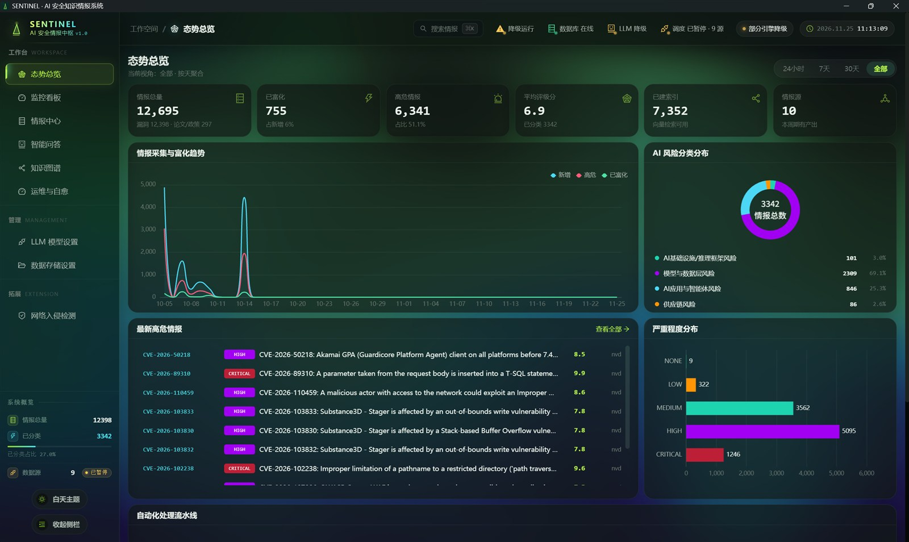
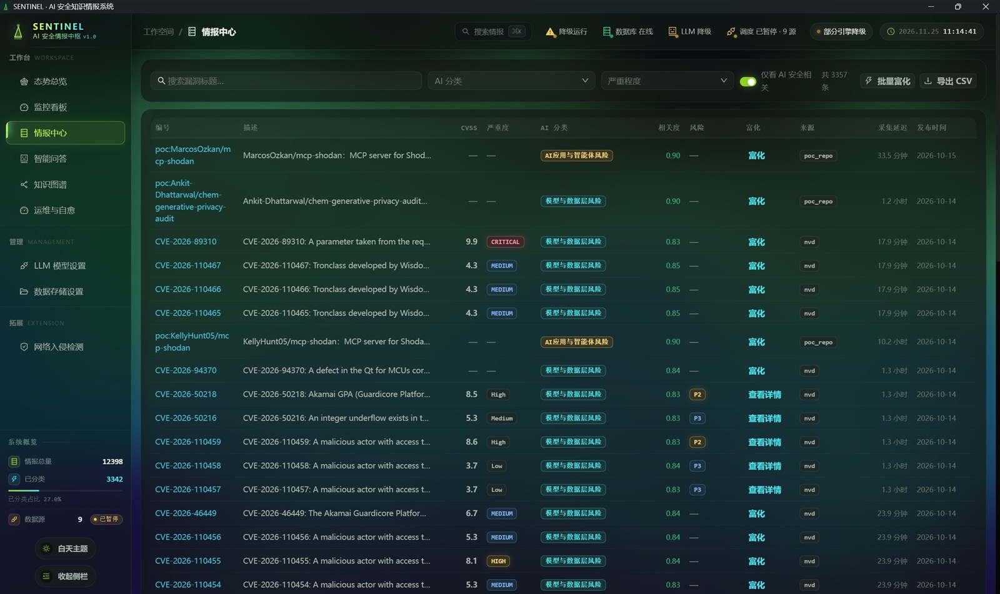
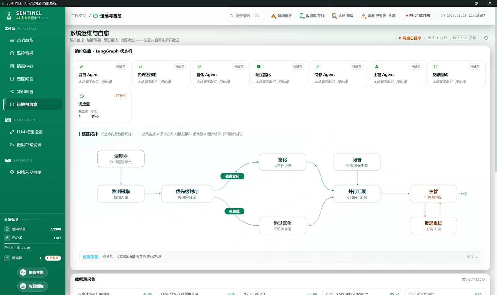
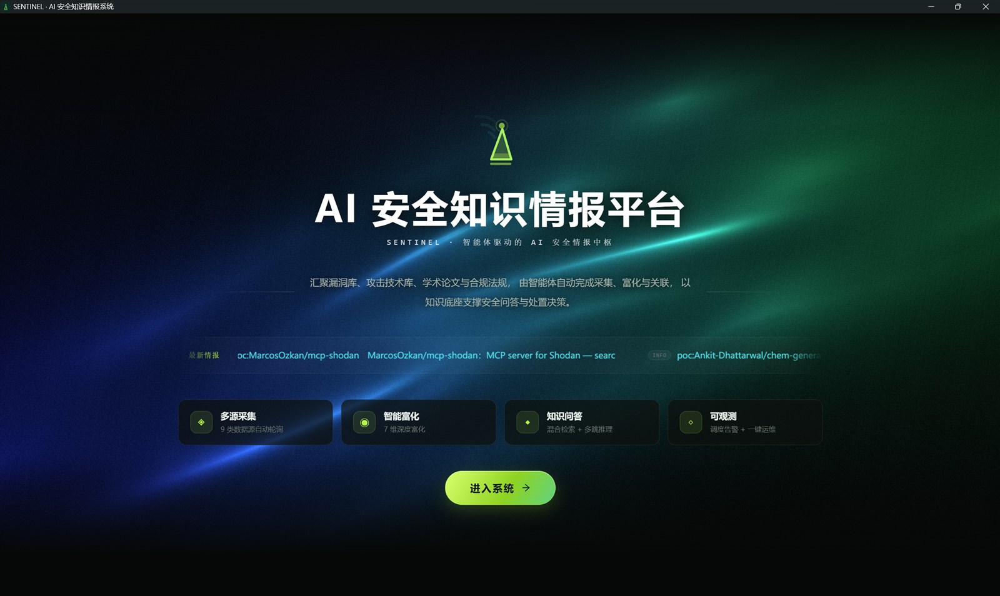
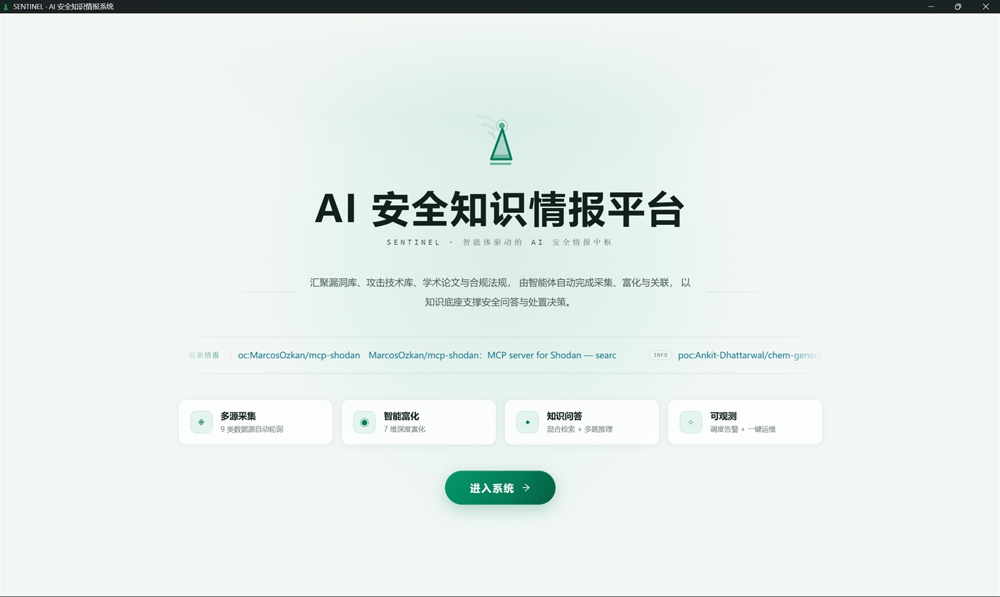
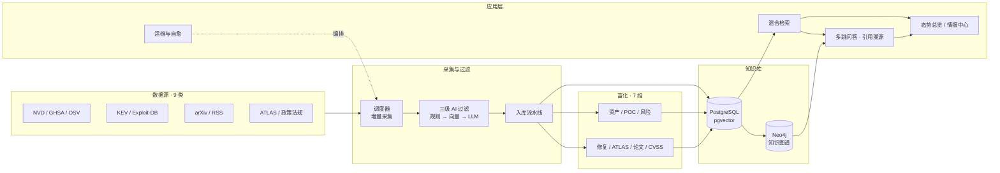

# SENTINEL · AI 安全知识情报系统

> 智能体驱动的 AI 安全知识情报平台 —— 9 类数据源自动采集 · 三级 AI 过滤 · 7 维精准富化 · 知识图谱多跳问答
>
> 中国电子杯第三届高校 ICT 产教融合创新大赛 · 赛题九 参赛作品（网信产业应用赛道）


---

## 界面预览

| 态势总览 · 监控看板 | 情报中心 · 采集与富化 |
|---|---|
|  |  |

| 运维与自愈 · LangGraph 编排链路 | 落地首页 · 黑夜 / 白天双主题 |
|---|---|
|  |  |

<p align="center">
  
</p>

---

## 项目简介

SENTINEL 面向 AI 安全领域的情报分散、更新滞后、难以溯源等问题，构建了一条
**采集 → 过滤 → 富化 → 关联 → 问答** 的全自动情报流水线：

- **自动采集**：覆盖 NVD、GitHub Advisory、OSV、CISA KEV、Exploit-DB、arXiv、社区 RSS、
  MITRE ATLAS、政策法规共 **9 类数据源**，调度器按源配置独立周期增量拉取。
- **三级 AI 过滤**：规则匹配 → 向量相似度 → LLM 复核，从海量通用漏洞中筛出真正属于
  AI 安全范畴的条目，兼顾召回率与准确率。
- **7 维富化**：资产影响、POC 可用性、风险评分、修复方案、MITRE ATLAS 技术映射、
  论文关联、CVSS 重算，每条情报形成可执行的结构化画像。
- **知识图谱问答**：实体关系实时入图（Neo4j），支持混合检索 + 图谱多跳 + 引用溯源，
  回答可定位到原始情报与数据源。
- **可观测与自愈**：LangGraph 状态机编排 Monitor / Enrich / QA / 主管 Agent，
  Prometheus 指标 + 调度看板 + 失败重试，运行状态一目了然。
- **拓展模块 ROEN**：移植自团队科研项目的网络入侵检测模型（GCN + LSTM 双线程），
  演示「攻击事件 → 系统锁定 → 图像混沌加密 → 口令解锁」的安全响应闭环。

## 核心指标

| 赛题指标 | 要求 | 实测 |
|---|---|---|
| 情报监测数据源 | ≥ 7 类 | **9 类**（漏洞库 / 社区 / 学术 / 标准 / 政策法规），累计入库 8,000+ 条 |
| 富化维度 | ≥ 5 维（优秀 7 维） | **7 维全覆盖** |
| 富化完整度 | ≥ 80% | **100%** |
| 富化准确率 | ≥ 90% | **100%**（20/20 基准） |
| 问答准确率 | ≥ 85% | **96.46%**（198 题评测集） |
| 问答响应 P95 | ≤ 5s | **1694 ms** |
| 多跳推理正确率 | ≥ 80% | **100%** |
| 监测时效 P95 | ≤ 12h（优秀 6h） | **1.7s**（增量采集实测） |

## 系统架构



## 快速开始

### 方式一：便携运行包（免安装，推荐体验）

发布包内置 Python、PostgreSQL、Neo4j、Java 与前端页面，**无需安装 Docker / Python / 数据库**：

1. 解压发布包到任意目录（建议英文路径）；
2. 双击 `Sentinel.exe`，等待初始化（首次约 1~3 分钟）；
3. 启动完成后自动弹出应用窗口。

> 仓库不存放约 850MB 的运行包与演示数据库；可在 `app/` 下执行
> `pyinstaller Sentinel.spec` 后用 `app/发布/组装发布包.sh` 自行组装，或联系作者获取。

### 方式二：源码运行（开发者）

环境：Windows 10/11 · Python 3.13 · Node.js 18+ · Docker Desktop

```bash
# ① 安装后端依赖
cd app
python -m venv .venv
./.venv/Scripts/pip.exe install -r requirements.txt

# ② 配置环境变量（不填 Key 则使用内置网关）
cp .env.example .env

# ③ 启动数据层（PostgreSQL+pgvector / Redis / Neo4j）
docker compose -f 运维/docker-compose.全栈.yml up -d postgres redis neo4j

# ④ 启动后端（同时托管前端构建产物）
./.venv/Scripts/python.exe -m uvicorn 项目源码.后端服务.app:app --host 0.0.0.0 --port 8000
```

前端开发模式：

```bash
cd app/前端界面
npm install
npm run dev        # http://localhost:5173
```

更多细节（FAQ、LLM 配置、打包流程）见 **[app/README.md](app/README.md)**。

## 目录结构

```
Sentinel/
├── Sentinel.exe · 停止系统.exe     Windows 启动器（C#，源码见 portable/Launcher.cs）
├── portable_bootstrap.py           便携启动逻辑：私有数据库 → 快照恢复 → 服务 → 窗口
├── portable/                       启动器源码、图标、构建说明
├── docs/screenshots/               README 界面截图
├── app/                            ★ 完整源码工作区
│   ├── 项目源码/                     FastAPI 后端
│   │   ├── 后端服务/                 配置 · LLM 客户端 · API 路由 · 指标 · 运维
│   │   ├── 数据采集/                 9 类采集器 · 三级分类器 · 入库流水线 · 调度器
│   │   ├── 富化模块/                 7 维富化器 · 并行编排
│   │   ├── 问答模块/                 嵌入 · 混合检索 · 意图 · 图谱 · 自由问答 Agent
│   │   ├── 智能体编排/               LangGraph 状态机 · 多 Agent 协作
│   │   └── 拓展模块/                 ROEN 入侵检测 · 混沌加密 · 流量模拟
│   ├── 前端界面/                     React 18 + TS + Vite + AntD 5 + ECharts
│   │   ├── src/                      前端源码
│   │   └── dist/                     构建产物（后端直接托管）
│   ├── 评测/                         pytest 单元测试（107 项）· 性能压测 · 评测集
│   ├── 运维/                         Docker Compose · Dockerfile · Prometheus / Grafana
│   ├── 归档/                         技术报告 · 答辩 PPT · 界面截图
│   ├── MD1.0/                        ROEN 网络入侵检测研究子项目
│   ├── Sentinel.spec                 PyInstaller 打包配置
│   ├── 启动系统.bat / .sh             源码模式一键启动
│   ├── 首次安装.bat                   首次安装依赖与数据层容器
│   └── README.md                     ★ 开发文档
└── runtime/ pgsql/ neo4j/ java/ data/ 内嵌运行时与数据（不入库，随发布包分发）
```

## 开发与测试

```bash
cd app

# 单元测试（107 项）
./.venv/Scripts/python.exe -m pytest 评测/tests/ -q

# 接口并发压测
./.venv/Scripts/python.exe 评测/性能压测.py

# 重新打包 exe（可选）
./.venv/Scripts/pyinstaller.exe Sentinel.spec --noconfirm --distpath 发布/_build
```

## 技术栈

| 层次 | 技术选型 |
|---|---|
| 后端框架 | FastAPI · SQLAlchemy 2 · Pydantic 2 · asyncpg |
| 数据层 | PostgreSQL 16 + pgvector · Redis · Neo4j 5 |
| 智能体 | LangGraph · 多 Agent 状态机 · DeepSeek / 智谱 / 通义 / 本地 Ollama |
| 检索与模型 | BGE 中文嵌入（sentence-transformers）· 混合检索 · 图谱多跳 |
| 前端 | React 18 · TypeScript · Vite · Ant Design 5 · ECharts · Three.js |
| 交付与运维 | PyInstaller · 内嵌 PostgreSQL/Neo4j/Java · C# 启动器 · Prometheus / Grafana |

## 文档导航

| 文档 | 说明 |
|---|---|
| [app/README.md](app/README.md) | 安装、启动、配置、打包、FAQ |
| [app/归档/技术报告](app/归档/技术报告) | 系统设计、实现细节与评测数据 |
| [app/评测](app/评测) | 单元测试、性能压测、评测集 |
| [app/运维](app/运维) | 容器编排、监控告警、部署配置 |

## 说明

- 情报数据均来自公开漏洞库、安全公告、学术论文与政策法规，系统仅做聚合、富化与检索。
- 仓库未包含运行包、演示数据库与嵌入模型（体积原因），`.gitignore` 已注明。
- 本项目为赛事参赛作品，暂未附开源许可证；如需引用或二次开发请联系作者。
