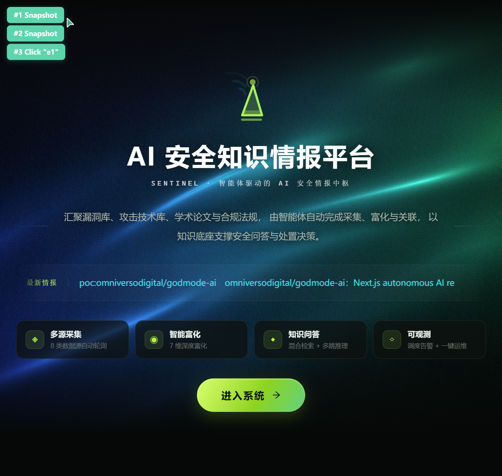
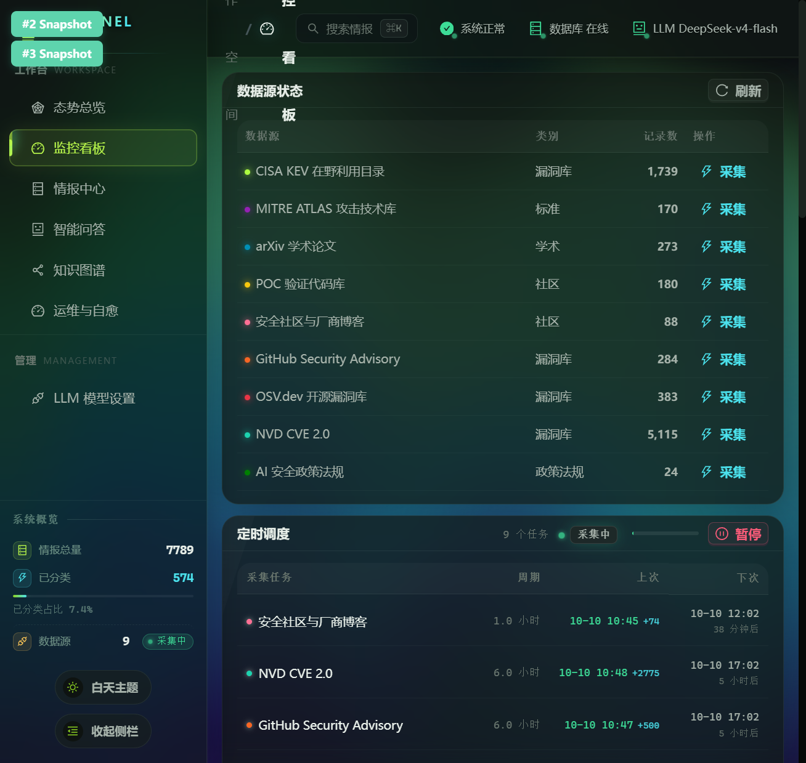
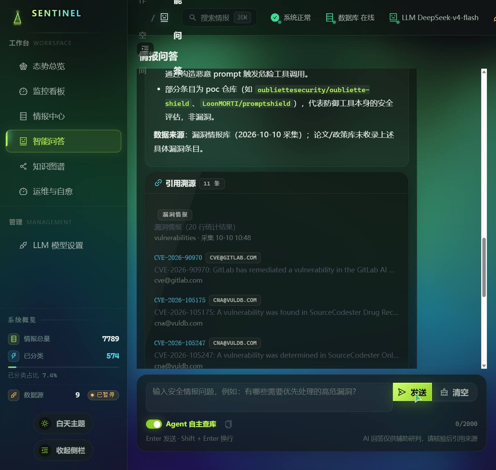
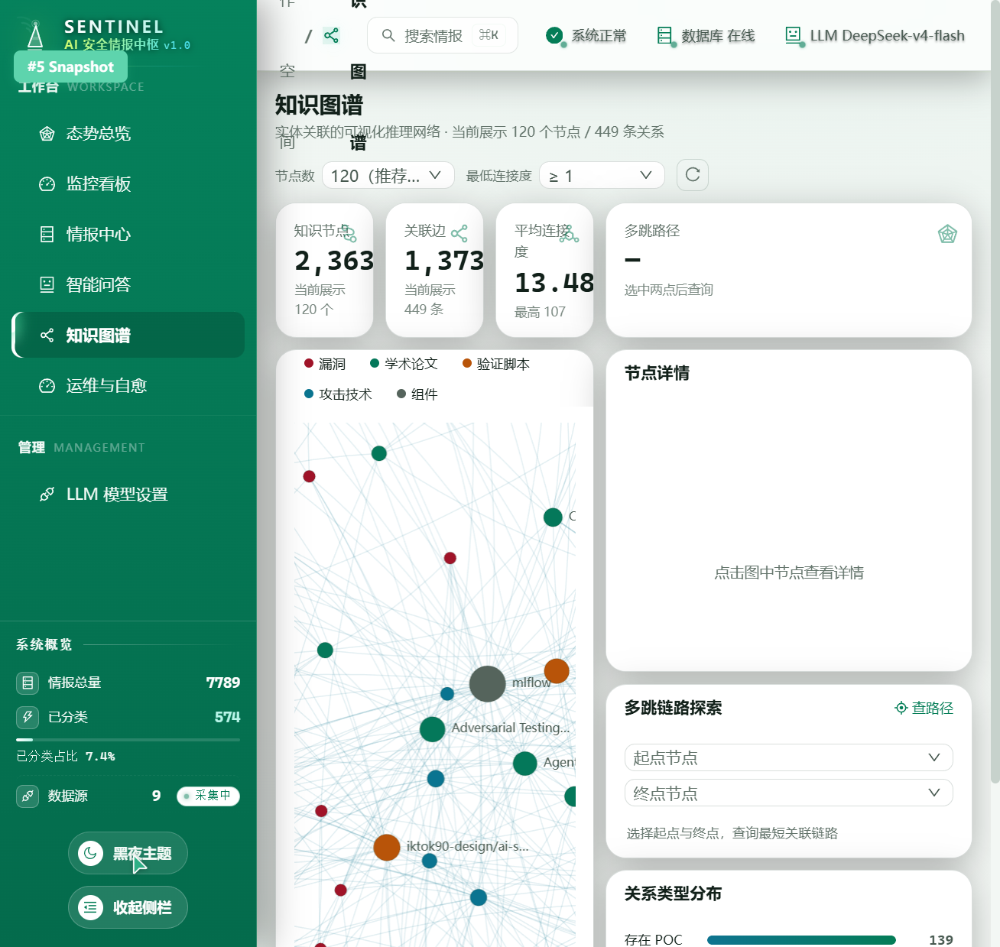
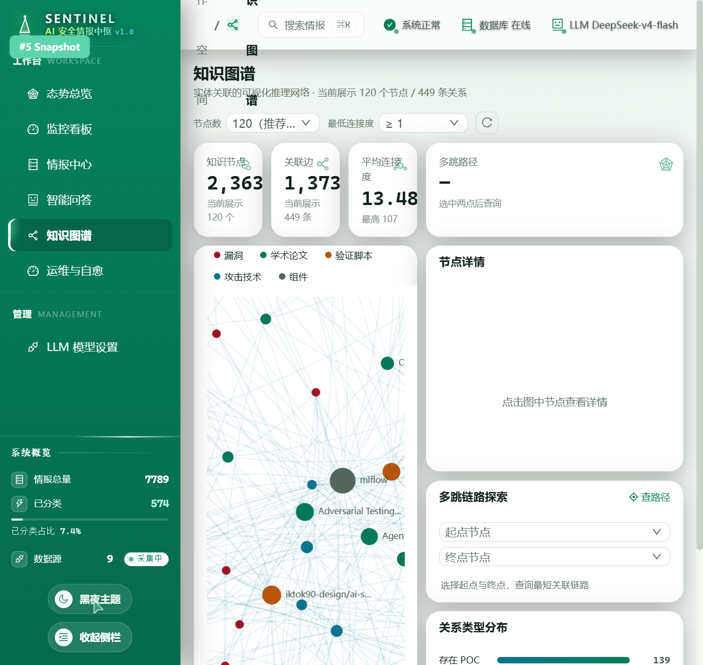
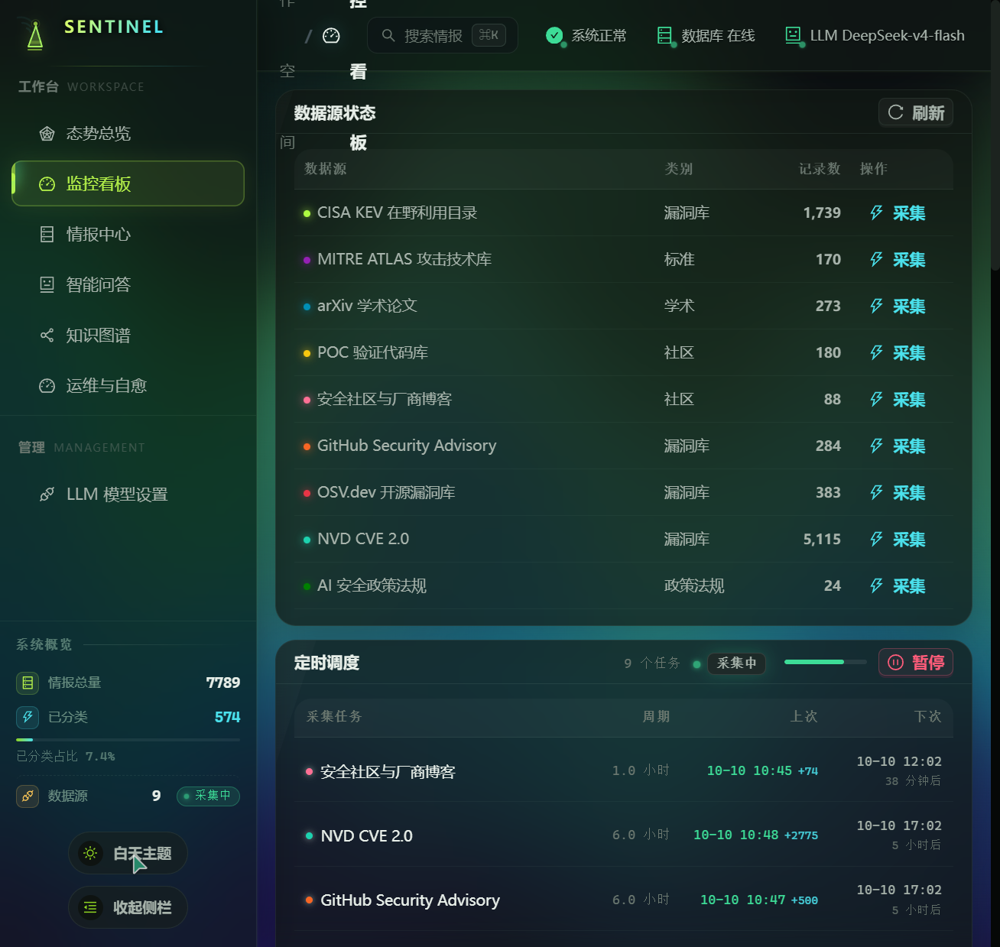

# AI 安全知识情报系统（SENTINEL）

> 中国电子杯第三届高校 ICT 产教融合创新大赛 · 赛题九
> 智能体驱动的 AI 安全知识情报系统设计与实现（网信产业应用赛道）

一个多智能体协作的 AI 安全情报平台：自动采集 9 类数据源，用三级过滤筛出
真正属于 AI 安全范畴的漏洞，做 7 维精准富化，再通过知识图谱支撑
可溯源的多轮问答与多跳推理。

---

## 界面预览

<p align="center">
  
  
</p>
<p align="center">
  
  
</p>
<p align="center">
  
  
</p>

> 全站支持黑夜 / 白天双主题（对比度按 WCAG AA 标准实测校准）。

---

## 核心指标

| 赛题指标 | 要求 | 实测 |
|---|---|---|
| 情报监测数据源 | ≥7 类 | **9 类**（漏洞库/社区/学术/标准/政策法规），累计入库 8,000+ 条 |
| 富化维度 | ≥5 维优秀 7 维 | **7 维全覆盖** |
| 富化完整度 | ≥80% | **100%** |
| 富化准确率 | ≥90% | **100%**（20/20 基准） |
| 问答准确率 | ≥85% | **96.46%**（198 题评测集） |
| 问答响应 P95 | ≤5s | **1694ms** |
| 多跳推理正确率 | ≥80% | **100%** |
| 监测时效 P95 | ≤12h 优秀 ≤6h | **1.7s**（增量采集实测） |

---

# 如何运行

> ### 📦 打包版 exe 不在代码仓库里
> GitHub 限制**仓库单文件最大 100MB**，而 exe 发布包约 850MB、压缩后 336MB，
> 均无法存入仓库。因此打包版通过 **GitHub Releases** 分发：
>
> 👉 **下载入口**：<https://github.com/JoffinLu/ICT-WB/releases/tag/v1.0>
> - `Sentinel-Full-v1.0.zip` → 解压得 `Sentinel-系统-完整版/`（**推荐**，含 8,000+ 条演示数据）
> - `Sentinel-Lite-v1.0.zip` → 解压得 `Sentinel-系统-纯净版/`（空库，测试从零采集）
>
> 解压后双击 `Sentinel.exe` 即可（见下方「方式一」）。
> 若仓库为私有，需先由作者将你添加为协作者方可访问 Releases。

**先看清你手里拿到的是什么**，对应不同方式：

| 你拿到的 | 走哪节 |
|---|---|
| 从 Releases 下载并解压出的 `Sentinel-系统-完整版 / 纯净版` 文件夹（内含 `Sentinel.exe`） | **方式一：打包版**（3 步启动） |
| 项目源码文件夹 / 从本仓库 `git clone` 的代码 | **方式二：源码版**（开发者向） |

> 两种方式都 **必须安装 Docker Desktop**（原因见下）。

## 前置要求：Docker Desktop（必须）

本系统的数据层（PostgreSQL + pgvector / Redis / Neo4j）以 Docker 容器运行，
**无论打包版还是源码版，都需要先安装并运行 Docker Desktop**。

1. 下载安装：<https://www.docker.com/products/docker-desktop/>
   （Windows 10/11 64 位；安装时勾选 WSL2 后端）
2. 安装后启动 Docker Desktop，等左下角状态变为 **引擎运行中 / 图标变绿**
3. 验证：打开终端执行 `docker version` 能输出版本即成功

> 为什么必须 Docker？——向量检索（pgvector）、图数据库（Neo4j）这类服务
> 在 Windows 上没有可靠的免安装形态；容器化同时保证了"一键部署"。
> 好消息：只需安装一次，之后每次启动都是秒级复用。

## 方式一：打包版（推荐演示 / 评审使用）

> **前提**：已从 [Releases](https://github.com/JoffinLu/ICT-WB/releases/tag/v1.0)
> 下载并解压出 `Sentinel-系统-完整版/` 或 `Sentinel-系统-纯净版/` 文件夹。

### 完整版 vs 纯净版，选哪个？

| | **完整版**（约 850MB） | **纯净版**（约 780MB） |
|---|---|---|
| 附带数据 | ✅ 含 8,000+ 条演示数据（首次启动**自动导入**） | ❌ 空库启动 |
| 打开就能看到 | 情报列表 / 富化结果 / 图谱 / 问答全都有数据 | 页面是空的，需手动触发采集 |
| 适用场景 | 答辩演示、评审体验、快速上手 | 测试"从零采集"全流程、干净部署 |
| 首次启动耗时 | 5~10 分钟（拉镜像 + 导入数据） | 5~10 分钟（拉镜像） |

**演示/体验请选完整版；想看系统自己采集数据选纯净版。**

### 启动步骤（三步）

1. 确认 Docker Desktop 已在运行（图标变绿）
2. 双击文件夹里的 **`Sentinel.exe`**，会弹出一个黑色控制台窗口显示进度：
   ```
   [SENTINEL] Docker 就绪 [OK]
   [SENTINEL] 启动数据层容器（首次运行需拉取镜像，可能较慢，请耐心等待）…
   [SENTINEL] 数据容器已启动 [OK]
   [SENTINEL] PostgreSQL 就绪 [OK]
   [SENTINEL] 检测到数据库已有数据 / 首次启动：正在导入数据快照…
   [SENTINEL] 正在启动服务（约需 20~40 秒）—— 就绪后将自动弹出应用窗口…
   ```
3. 等待 **20~40 秒**（首次运行 5~10 分钟，正在拉取镜像），系统会自动弹出一个
   **独立应用窗口**（无浏览器地址栏），里面就是完整系统。

### 关闭与再次启动

- **关闭**：直接关掉应用窗口即退出程序；数据容器保留在 Docker 中
  （下次启动秒级复用，无需重新初始化）
- **再次启动**：确认 Docker 在运行 → 重新双击 `Sentinel.exe` 即可
- 若提示"8000 端口已有服务运行"，说明系统已经在跑，会直接打开界面

### 常见问题（FAQ）

| 现象 | 原因与处理 |
|---|---|
| 双击后提示「未检测到 Docker」 | 未安装 Docker Desktop，按上文安装 |
| 提示「Docker 已安装但未运行」 | 启动 Docker Desktop，等图标变绿后重试 |
| 首次启动停留很久 | 正在拉取镜像（约 500MB），属正常；之后启动只需 1 分钟内 |
| 控制台一闪而过 | 系统已在运行或报错退出，重新双击一次看提示 |
| 应用窗口没弹出 | 极少数环境缺 WebView2 运行时；改用命令行启动 `Sentinel.exe --browser` 回退浏览器模式 |
| 采集功能不工作 | 检查网络能否访问外网（NVD/GitHub/arXiv 等上游） |

### LLM 配置（可选）

系统内置默认 LLM 网关可直接使用。如需接入自己的 API Key（推荐正式使用）：
首页右上角「**LLM 模型设置**」→ 添加模型（支持 DeepSeek / 智谱 / 通义千问 /
Kimi / OpenAI / Ollama 本地等预设）→ 保存并生效。支持保存多个模型一键切换。

## 方式二：源码版（开发者）

### 环境要求

- Windows 10/11，Python **3.13**，Node.js **18+**，Docker Desktop（见上文）

### 启动步骤

```bash
# ① 安装 Python 依赖（首次）
python -m venv .venv
./.venv/Scripts/pip.exe install -r requirements.txt

# ② 配置环境变量（首次）
cp .env.example .env            # 按注释填入 LLM_API_KEY（不填则用内置网关）

# ③ 启动数据层容器（PostgreSQL / Redis / Neo4j）
docker compose -f 运维/docker-compose.全栈.yml up -d postgres redis neo4j

# ④ 启动后端（会同时托管前端构建产物；首次启动需 30~110 秒预热）
export NO_PROXY="127.0.0.1,localhost"
./.venv/Scripts/python.exe -m uvicorn 项目源码.后端服务.app:app --host 0.0.0.0 --port 8000

# ⑤ 启动前端开发服务器（开发模式热更新；生产模式跳过这步，直接访问 8000）
cd 前端界面 && npm install && npm run dev    # http://localhost:5173
```

也可以使用一键脚本：

```bash
bash 启动系统.sh          # 启动全部
bash 启动系统.sh status   # 状态与数据概览
bash 启动系统.sh enrich 30 # 批量富化
```

> 提示：生产/演示部署推荐先 `cd 前端界面 && npm run build`，之后后端单进程
> （8000 端口）即可同时提供前端与 API，无需再跑 5173。

### 运行测试

```bash
./.venv/Scripts/python.exe -m pytest 评测/tests/ -q       # 单元测试（107 项）
./.venv/Scripts/python.exe 评测/性能压测.py                # 接口并发压测
```

### 打包成 exe（可选）

```bash
./.venv/Scripts/pyinstaller.exe Sentinel.spec --noconfirm \
    --distpath 发布/_build --workpath build/pyinstaller
bash 发布/组装发布包.sh    # 组装「完整版 / 纯净版」两份发布包
```

---

## 项目结构

```
ICT-WB/
├── 项目源码/                 后端全部源码（FastAPI + 多智能体编排）
│   ├── 后端服务/             配置 · 日志 · LLM 客户端 · API 路由 · 指标
│   ├── 知识库/               ORM 模型 · 数据库连接
│   ├── 数据采集/             9 类采集器 · 三级 AI 分类器 · 入库流水线
│   ├── 富化模块/             7 维富化器 · 并行编排器
│   ├── 问答模块/             嵌入 · 混合检索 · 意图识别 · 图谱 · 问答编排
│   ├── 智能体编排/           LangGraph 状态机 · 多 Agent 协作
│   ├── 启动器.py             ★ exe 打包入口：Docker 检测 → 容器 → 首启导入 → 服务
│   └── 运行时.py             开发/打包双环境路径解析
├── 前端界面/                 React 18 + TS + Vite + AntD 5 + ECharts
│   └── dist/                 构建产物（后端生产模式直接托管它）
├── 数据/                     模型缓存（BGE 嵌入模型，约 96MB）与运行日志
├── 评测/                     pytest 测试（107 项）· 性能压测脚本 · 评测集
├── 运维/                     Docker Compose（数据层/全栈）· Dockerfile · 监控配置
├── 发布/                     ★ exe 打包输出与组装脚本
│   ├── Sentinel-系统-完整版/  （发布包本体不入库；从作者处获取或 GitHub Releases）
│   ├── Sentinel-系统-纯净版/
│   └── 组装发布包.sh          重建发布包：PyInstaller 产物 → 两份包
├── 归档/                     交付物与历史材料
│   ├── 技术报告/             技术报告 docx · 答辩讲解 PPT · 插图 · 截图 · 生成脚本
│   ├── 讲解PPT/              讲解 PPT 素材
│   └── 讲解视频/             演示视频素材
├── Sentinel.spec             PyInstaller 打包配置
├── 启动系统.sh               源码模式一键脚本
└── requirements.txt          Python 依赖
```

> **找发布包（exe）**：本仓库不存放打包产物（约 1.6GB）。
> 请在 `发布/` 目录按 `组装发布包.sh` 自建，或直接向作者获取
> `Sentinel-系统-完整版 / 纯净版` 文件夹。

---

## 系统架构

```
┌────────────────────────────────────────────────────────────┐
│  可视化层  React + TypeScript + Ant Design + ECharts        │
│  监控看板 · 情报中心 · 智能问答                               │
└────────────────────────┬───────────────────────────────────┘
                         │
┌────────────────────────┴───────────────────────────────────┐
│  编排层  LangGraph 状态机                                     │
│  监测 Agent → 优先级判定 → (富化 ∥ 问答) → 主管反思          │
│  条件边 · 并行节点 · 反思循环 · 人工介入                       │
└────────────────────────┬───────────────────────────────────┘
                         │
┌────────────────────────┴───────────────────────────────────┐
│  能力层                                                      │
│  ① 情报监测  9 类数据源 · 增量游标 · 跨源去重               │
│  ② AI 分类   规则 → 嵌入 → LLM 三级过滤                     │
│  ③ 精准富化  7 维并行 · 置信度分层                            │
│  ④ 情报问答  混合检索 · 图谱多跳 · 引用溯源                  │
└────────────────────────┬───────────────────────────────────┘
                         │
┌────────────────────────┴───────────────────────────────────┐
│  存储层  PostgreSQL+pgvector │ Neo4j │ Redis                 │
│  监控层  Prometheus + Grafana（12 面板）+ Alertmanager 规则    │
└────────────────────────────────────────────────────────────┘
```

---

## 三个关键技术难点

### 难点一：AI 漏洞占比不足 1%

实测 NVD 7 天窗口的 2563 条 CVE，真正属于 AI 安全范畴的不足 1%
（第一条是 CloudClassroom-PHP，第二条是 OCI registry）。

若不过滤，系统将退化为普通漏洞库，完全偏离赛题定位。

**三级递进过滤**：

```
规则层（零成本）  13 类 90+ 关键词 + 38 个排除词 + 60 个 AI 组件
      ↓ 灰区
嵌入层           bge-small-zh 语义相似度，12 条基准语句
      ↓ 仍灰区
LLM 层           批量复核（每批 5 条，预算上限 6 批）
      ↓ 超预算
启发式兜底       AI 组件倾向保留，标记待核验
```

结果：GHSA 500 条中识别出 40 条（8%）真 AI 漏洞，包括 NLTK 模型投毒、
Gradio 路径穿越、MLflow SSRF、BlenderMCP、ChromaDB 注入等真阳性。

### 难点二：富化的可信度分层

让 LLM 生成的内容无法直接采信。设计了**置信度分层机制**：

- **高置信（≥0.8）**：CVSS 规范公式计算、官方数据源——可直接采信
- **中置信（0.5-0.8）**：规则推断——展示并标注
- **低置信（<0.5）**：进入人工核验队列，不计入准确率分母

以 CVSS 为例：3.1 基础分是确定性数学计算，**不交给 LLM 猜**。
实现的公式与 NVD 官方数据交叉验证，2119/2274 条完全一致。

### 难点三：响应时间保障

免费网关限流时，单次 LLM 调用重试 3 次可耗 30-50 秒，远超赛题 5 秒要求。

**三层保护**：

| 层次 | 机制 |
|---|---|
| 意图识别 | 规则覆盖 80% 查询 + 1.5s 硬超时 |
| 答案生成 | 4.2s 总预算 + 1.6s LLM 硬超时 |
| LLM 客户端 | 熔断器（429 后进入冷却） |

效果：P95 从 17 秒降至 1.7 秒。

---

## 常用命令

```bash
# 采集
curl -X POST http://localhost:8000/api/collect/ghsa
curl -X POST http://localhost:8000/api/collect/all

# 富化
curl -X POST "http://localhost:8000/api/enrich-batch?limit=20"

# 问答
curl -X POST "http://localhost:8000/api/qa/ask?question=CVE-2021-43831%20怎么修复"

# 智能体编排
curl http://localhost:8000/api/orchestration/graph          # 图结构
curl http://localhost:8000/api/orchestration/agents         # Agent 健康
curl -X POST "http://localhost:8000/api/orchestration/run?workflow_type=qa&question=mlflow有哪些漏洞"

# 全量 API 文档
# 浏览器打开 http://localhost:8000/docs
```

---

## 交付物

| 交付物 | 位置 |
|---|---|
| 系统（源码 + exe 发布包） | 本仓库 / `发布/`（按脚本自建或向作者获取） |
| 技术报告 | [归档/技术报告/AI安全知识情报系统技术报告.docx](归档/技术报告/AI安全知识情报系统技术报告.docx) |
| 答辩讲解 PPT | [归档/技术报告/SENTINEL_答辩讲解PPT.pptx](归档/技术报告/SENTINEL_答辩讲解PPT.pptx) |
| 界面截图（双主题） | [归档/技术报告/截图/](归档/技术报告/截图/) |
| 评测数据 | [归档/技术报告/数据/](归档/技术报告/数据/) · [评测/](评测/) |

---

## 技术栈

| 层 | 技术 |
|---|---|
| 采集 | httpx · feedparser · BeautifulSoup · APScheduler |
| 分类/富化 | 规则引擎 · bge-small-zh · DeepSeek-v4-flash |
| 存储 | PostgreSQL 16 + pgvector（HNSW）· Neo4j 5 · Redis 7 |
| 检索 | 混合检索 + RRF 融合 |
| 编排 | LangGraph（条件边 · 并行 · 反思循环） |
| 后端 | FastAPI · SQLAlchemy 2.0 · Pydantic |
| 前端 | React 18 · TypeScript · Ant Design 5 · ECharts |
| 桌面分发 | PyInstaller · pywebview（WebView2）· Docker Compose |
| 运维 | Prometheus · Grafana · GitHub Actions |
